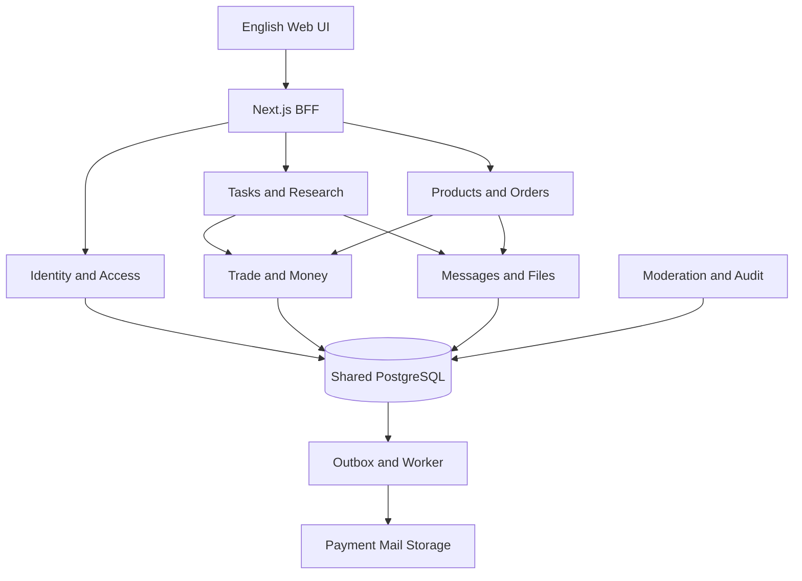

# Source plan from ChatGPT

Read back from “规划报告与技能添加”, completed on 2026-10-09. Planning proposals are not implementation or production acceptance evidence. Human requirements and later decisions take precedence.

**建议保留现有英文前端，以“Next.js BFF＋模块化业务服务＋托管 PostgreSQL＋独立 worker”重建后端。** 首先解决共享市场、身份权限、履约一致性和资金一致性，再接入真实支付。

已整理为可下载文档：[Campus_Bounty_后端开发策划方案.docx](sandbox:/workspace/scratch/3bfd2e0093fc/Campus_Bounty_后端开发策划方案.docx)。完整方案正文如下。

本方案依据你提供的实现摘要，**未审查业务源码、服务器或数据库；本轮没有编写产品实现、部署或改动现有服务**。容量、费用、技术选择和验收指标均明确作为建议，不是已测结果。

---

## A. 后端问题诊断

项目定位保持为：**美国高校社区的悬赏与商品市场**。教授、学生、研究人员及其他准入成员可以发布任务；学生申请、履约并获得奖金；完整科研项目属于任务；同一账号可以交易实物和数字商品。

有限学校试点可以作为运营建议，但不能改变上述产品范围。

优先级：

- **P0：** 开放真实账号或真实资金前必须解决。
- **P1：** 共享内测前必须解决。
- **P2：** 出现实际规模需求后优化。

| 摘要证据中的现状 | 真实业务风险 | 优先级 | 改造目标 |
|---|---|---|---|
| 每个浏览器 Cookie 对应独立 SQLite | 用户看不到彼此新增的任务和商品，无法形成市场 | P1 | 共享业务数据库；公开目录与私有交易数据分别授权 |
| 主体业务存于一个 JSON 文档，整体更新 | 关系、唯一性和金额约束难落实；写竞争集中；审计困难 | P1 | 关系表、数据库约束、按业务对象划分事务 |
| `/api/action` 分发到大型 `store.command` | 权限、状态转换和副作用难逐项审核 | P1 | 资源 API、明确用例层、逐命令授权 |
| `/api/state` 返回聚合状态 | 数据增长后过度读取；新增字段可能扩大隐私暴露面 | P1 | 显式响应 DTO、分页查询、按用途聚合 |
| 验证码回显、六所示例学校、虚构角色快捷登录 | 不构成真实校邮认证，角色身份不能作为事实 | P0 | 审核学校目录、真实邮件验证、生产禁用演示入口 |
| 支付仅有 `demo_only` | 没有实际付款、账本、退款或结算事实 | P0 | 支付适配、事件处理、账本、对账和异常补偿 |
| 已有基本对象权限和整数美分 | 可以复用设计经验，但不能证明全部异常路径正确 | P0/P1 | 权限矩阵、数据库不变量、越权和并发测试 |
| 无网络演示容器，共享宿主资源有限 | 无法接入外部依赖；增加重型服务可能影响其他项目 | P0 | 优先独立生产基础设施；同机方案设资源和出网门禁 |
| 已通过演示、单元、无障碍及恢复测试 | 不覆盖真实身份、支付、并发、负载和生产安全 | P0 | 重新定义内测与真实交易验收证据 |

**需要进一步检查的假设：** Cookie 属性、CSRF/Origin 校验、输入验证、附件权限、错误脱敏、依赖风险、事务竞态、备份有效性及隔离配置是否存在缺口。

目前没有证据认定这些具体漏洞已经发生。后续获得仓库访问后，应先做只读核对，并逐项标记“已证实”“未发现”“待核验”。

---

## B. 起步架构与关键备选

### B1. 推荐架构

浏览器只调用 BFF：

- **Route Handler：** 认证入口、输入校验、响应格式、错误转换。
- **应用服务：** 发布任务、接受邀请、下单、提交、验收、退款等业务命令。
- **领域规则：** 状态转换、资格、金额、库存、履约约束。
- **仓储与事务单元：** SQL、锁、版本检查、数据库提交。
- **外部适配器：** Auth、邮件、支付、对象存储。
- **独立 worker：** 邮件、回调处理、扫描、超时任务、对账和重试。



这里表示模块及主要依赖，**不是微服务拆分**。模块保留在同一后端代码库中；worker 可以独立运行和限额。

同步跨模块用例可以共用一个数据库事务。外部请求通过 outbox 衔接，不能持有数据库锁等待邮件或支付网络响应。

### B2. 方案比较

| 方案 | 适用条件与收益 | 代价和边界 | 建议 |
|---|---|---|---|
| Next BFF＋服务层＋托管 Postgres | 主要服务一个 Web 产品，已有 Next 前端 | 必须保持路由薄化；领域代码不能依赖 Next 请求对象 | **推荐起步** |
| 上述方案使用 Supabase | 希望组合使用托管数据库、Auth、对象存储 | 需要验证连接池、恢复能力、区域、撤销语义和成本；业务规则仍需自己实现 | 优先验证候选 |
| 分别选 Postgres、Auth、对象存储 | 有特殊身份、供应商独立性或区域要求 | 集成、运维和恢复边界更多 | 保留替换能力 |
| Next BFF＋独立 NestJS/Fastify 后端 | 独立后端团队、多客户端或独立发布节奏已形成 | 增加部署面、服务认证、追踪和契约同步 | 满足条件后再采用 |

NestJS 更便于施加统一模块结构；Fastify 更轻，但需要团队自行约束组织方式。把现有大函数搬入另一个框架不会自动解决权限、并发和账本问题。

Next 官方同样强调服务端数据访问和授权边界，因此保留 Next 并不妨碍建立严格后端。页面隐藏或按钮禁用不能代替命令授权。[官方资料](https://nextjs.org/docs/app/guides/data-security)。

建议形成六份架构决策记录：

1. 共享市场与校园资格。
2. 纯 BFF 会话。
3. Postgres 事务与 RLS。
4. 任务、订单、交易和资金的边界。
5. 支付模式及待核验条件。
6. 生产基础设施和恢复目标。

每份记录都写明理由、备选、退出条件和未决事项。

---

## C. 领域模型、表结构和数据生命周期

### C1. 通用设计约定

- 主键采用 UUID。
- 时间采用 `timestamptz`，服务端按 UTC 保存。
- 可变聚合使用 `version bigint` 做乐观锁。
- 发布、签约、交付、验收和金额快照不可覆盖。
- 金额使用 `bigint amount_minor` 加币种，不使用浮点数。
- API 金额建议使用十进制字符串：

```json
{
  "amount_minor": "12500",
  "currency": "USD"
}
```

第一版只支持 USD 是建议，尚未决定。费率使用基点或精确 NUMERIC，明确舍入规则并保存费用快照。

**学校是资格、归属和筛选维度，不默认是数据隔离租户。** 合格成员可以看到共享市场；邮箱、地址、申请、私聊、研究成果及账务按对象关系保护。

核心关系：

- 用户 → 高校资格 → 能力授权。
- 任务 → 条款版本 → 申请 → 邀请 → 履约协议 → 交付版本 → 验收。
- 商品 → 商品版本 → 报价 → 订单行 → 实物履约或数字授权。
- 履约协议或商品订单 → `trade` → 支付、退款、争议和账本。

建议 `trades` 使用两个显式外键：

- `task_agreement_id UNIQUE FK`
- `product_order_id UNIQUE FK`

CHECK 保证两者**恰好一个非空**。资金记录统一引用 `trade_id`，避免依赖无法建立外键约束的 `subject_type + subject_id`。

首版“一份协议一个学生收款人”“一个商品订单一个卖家”是降低复杂度的建议，不能当作用户已经排除了团队或多人科研。

### C2. 身份与高校准入

以下各表默认具有主键和必要时间字段。

| 表 | 关键字段和关系 | 约束、索引与说明 |
|---|---|---|
| `institutions` | name、country、status、可空 nces_unitid、证据版本 | 非空 UNITID 唯一；country/status 索引 |
| `institution_domains` | institution_id FK、domain、match_rule、审核状态、evidence_url、reviewed_by | 规范化域名；学校/域名/规则唯一；共享域名单独审核 |
| `users` | 稳定 user_id、account_status、restriction_version | 不因换邮箱生成新交易主体 |
| `user_profiles` | 昵称、头像、公开简介 | 与邮箱、地址和身份凭据分离 |
| `login_identities` | user_id FK、provider、provider_subject、email、verified_at | provider/subject 唯一；邮箱别名规则明确 |
| `affiliations` | user_id、institution_id、identity_id FK；verified_at、valid_until、status、evidence_type | 保留资格历史；当前关联唯一；到期索引 |
| `role_claims` | 自报 Student/Professor/Researcher | 不直接赋予高权限 |
| `capability_grants` | capability、来源、审批人、有效期 | 能力与自报角色分离 |
| `app_sessions` | user_id、sid_hash、expires_at、revoked_at、reauth_at | sid_hash 唯一；用户活动会话和到期索引 |
| `account_restrictions` | 限制范围、理由、有效期、审批人 | 区分新增交易限制与安全锁定 |
| `recovery_cases` | 账号、证据引用、审批、结果 | 恢复账号不改变订单所有者 |

验证码由认证供应商负责，或在专用 challenges 表保存哈希、用途、过期和尝试次数；不要同时维护两套互相矛盾的 OTP 权威状态。

**以上均属于身份功能首版。**

### C3. 悬赏与科研

| 表 | 关键字段和关系 | 约束与索引 |
|---|---|---|
| `tasks` | owner_id、kind、status、current_terms_id、capacity、version | status/published_at/id；owner/status |
| `task_terms` | task_id、revision、描述、奖金、币种、deadline、交付和验收要求、policy_version | task/revision 唯一；已发布版本不可变；当前条款必须属于任务 |
| `applications` | task_id、applicant_id、terms_id、proposal、status、version | 首版一用户一任务一申请记录；重投保存历史；禁止自申请 |
| `invitations` | application_id、task_id、recipient_id、terms_id、expires_at、status | 申请、收件人与条款归属一致；一次接受只创建一个协议 |
| `task_agreements` | task_id、application_id、publisher_id、assignee_id、原签约条款、effective_terms_id、status、version | 申请与协议唯一；有效名额约束；组合 FK 防跨任务关联 |
| `agreement_terms` | agreement_id、revision、协议条款快照 | 当前生效条款必须属于对应协议 |
| `agreement_amendments` | agreement_id、proposed_terms_id、双方确认、status | 修改提案使旧确认失效；生效时检查版本和资金条件 |
| `submissions` | agreement_id、revision、agreement_terms_id、作者、说明 | agreement/revision 唯一；交付不可覆盖 |
| `submission_files` | submission_id、asset_version_id | 附件必须属于授权上下文 |
| `reviews`、`acceptances` | agreement_id、submission_id、reviewer、decision、comment | 验收引用具体交付；组合 FK 防跨协议；首版最终验收唯一 |
| `agreement_events` | 操作者、from/to、reason、command_id | 与业务修改同事务追加 |
| 团队、里程碑和分账表 | 成员授权、阶段条款、金额分配 | **待用户决定后详细设计实施** |

完整科研项目首版需要能够表达：

- 长周期截止日期。
- 私有研究材料。
- 范围变更和延期。
- 多轮交付及修改。
- 明确的成果和验收标准。

不能把研究任务写死为短周期、低金额。

如果某项目必须依赖团队或里程碑，应在相应机制明确实现后开放这种交易结构，不能用错误的单人协议代替。

另外，`capacity > 1` 时必须明确奖金含义：

- **每份协议金额：** 每个接单人分别满足付款条件。
- **任务总预算：** 所有协议承诺金额之和不得超过预算。

建议保存 `reward_basis`。总预算模式下，名额和金额分配必须锁定同一任务聚合，不能只控制人数而超额承诺奖金。

### C4. 商品、库存和履约

| 表 | 关键字段和关系 | 约束与索引 |
|---|---|---|
| `products`、`product_versions` | seller_id、physical/digital、状态、价格、币种、成色、规格、数字许可、文件版本 | 上架版本不可变；seller/status、status/published_at/id |
| `inventory` | product/SKU、on_hand、reserved、version | `on_hand >= 0`；`0 <= reserved <= on_hand` |
| `inventory_reservations` | inventory_id、order_item_id、quantity、expires_at、status | 有效预占唯一；status/expires_at；释放和消耗至多一次 |
| `order_quotes` | buyer_id、商品/价格版本、费用、税、运费、总额、币种、政策版本、expires_at | 不可变；订单引用买方确认的报价 |
| `orders` | buyer_id、seller_id、quote_id、status、version | 禁止自购；首版单卖家一致性 |
| `order_items` | product_version_id、数量、单价、费用、许可快照 | 服务端定价；交易后不随商品编辑变化 |
| `physical_fulfillments`、`fulfillment_items` | order_id、订单行、数量、pickup/shipping、地址、tracking、交接码哈希 | 防超量履约；交接码单次；地址最小访问 |
| `digital_entitlements` | order_item_id、unit_index、asset_version_id、license_id、status | 订单行/单位/授权类型唯一；不超过购买数量 |
| `delivery_events` | 履约事实、操作者、证据 | 卖家交付与买家收货分开 |
| `return_cases`、`return_items` | 订单行、数量、退货原因、收货验收、重新入库结果 | 部分退款关联具体数量或授权单位 |

建议首版订单只有**一个卖家和一种履约类型**，待用户确认后在报价、下单和数据库写入路径一致校验。

即使一个订单包含多件商品，也要按订单行和数量履约；全部必要交付完成或合法终止后，订单才能完成。

数字商品分两类：

- 普通文件下载可以无限供应；个人许可如果不支持多份购买，明确 `quantity=1`。
- 序列号、兑换码、席位属于有限库存，按购买单位原子分配。

退款成功不代表实物已退回；退货验收后才能决定是否重新入库。

### C5. 通信、资金与治理

| 表组 | 关键设计 | 约束与边界 |
|---|---|---|
| `trades`、`trade_participants` | 统一关联协议或订单、买方和收款方 | 恰一个业务 FK；参与关系一致 |
| `conversations`、`conversation_members`、`messages` | 招募沟通关联申请；成交沟通关联 trade | 会话成员唯一；conversation/sequence 索引 |
| `assets`、`asset_versions` | 对象 key、hash、size、MIME、扫描状态、owner、保留类别 | 对象和版本唯一；字节版本不可覆盖 |
| 各业务附件关联表 | submission/message/product 等显式 FK | 客户端不能引用任意存储 key |
| `payment_accounts` | 外部账户、能力、入驻状态 | provider/account 唯一 |
| `funding_obligations` | 某笔交易的稳定应收义务 | 防止多个新幂等键创建重复收款 |
| `payment_attempts` | obligation、金额、币种、外部对象、status | 同一义务最多一个可支付或结果未知的有效尝试 |
| `money_operations`、`fund_allocation_reservations` | 退款/转账指令及持久金额预留 | PROCESSING/UNKNOWN 继续占用额度 |
| `refunds`、`transfers`、`transfer_reversals` | 原付款/转账、金额、原因、业务键、外部 ID、结果 | 业务效果和外部对象唯一；reversal 独立记录 |
| `payout_observations` | 收款账户至银行的状态 | 不假设一订单对应一笔 payout |
| `ledger_accounts`、`journal_entries`、`journal_lines` | 按币种的双分录控制账本 | 来源唯一、借贷平衡、入账不可改删 |
| `internal_disputes`、`provider_disputes` | 履约纠纷与支付机构拒付分开 | deadline/status 索引；证据和操作历史 |
| `cancellation_requests` | trade、申请人、理由、业务版本、决定 | 请求与批准分开，不直接跳改状态 |
| `webhook_inbox` | 原始事件引用、处理状态 | provider/account/event_id 唯一 |
| `outbox_events`、`jobs` | attempts、available_at、lease_until、error_code | 待处理局部索引；有界重试与死信 |
| `idempotency_records` | actor、operation、key、request_hash、结果 | actor/operation/key 唯一 |
| `notifications`、`notification_deliveries` | recipient、业务事件、channel、模板、投递结果 | event/recipient/channel 去重 |
| `reports`、`moderation_cases`、`audit_events` | 举报、分派、理由、决定、操作者及请求 ID | 最小访问；审计追加 |
| `policy_versions`、`policy_acceptances` | 费用、退款、许可、履约和隐私版本 | 已签约交易固定版本 |

资金和治理模块在开放真实交易前不能省略。推荐系统、高级搜索、复杂风控评分和自动客服可以后置。

FK 不会自动生成所有业务查询需要的索引。应根据高频关联、过滤和排序建立索引，避免“所有字段都建索引”。JSONB 可以保存供应商原始事件和受约束快照，不能继续承载整个平台状态。[PostgreSQL 约束文档](https://www.postgresql.org/docs/current/ddl-constraints.html)。

### C6. 生命周期

- 草稿可以修改或删除。
- 发布、签约、交付、验收和金额采用版本化记录。
- 下架撤销展示，不删除历史交易。
- 注销先撤销会话和新增交易能力，再处理存续义务。
- 可匿名化公开资料，但不能级联删除账本和争议证据。

保留策略必须逐类列出：用途、访问人、期限、到期动作、法律保留、备份消退窗口和负责人。

OTP、上传预留按短时有效期清理；无引用临时文件设置宽限期。财务、税务、争议和科研材料的年限需根据适用规则与合同核验，不能擅定“全部永久”或统一删除期限。

---

## D. 校邮注册、会话与权限

### D1. 学校目录和邮箱持有权

采用两层验证：

1. **机构与域名准入。**
2. **用户实际持有该邮箱。**

建议以 [NCES IPEDS](https://nces.ed.gov/ipeds/use-the-data) 的机构记录为基础，再逐校依据官方 IT/邮箱说明核对学生和教职员域名；[EDUCAUSE](https://net.educause.edu/eligibility.htm) 作为交叉证据。

IPEDS 不是现成校邮白名单，`.edu` 注册也不证明某个人当前在读或具有教授职称。

域名处理要求：

- 统一大小写和 IDNA。
- 精确匹配或使用明确审核过的子域规则。
- 支持经过审核的别名和共享域名。
- 拒绝 `school.edu.evil.com`。
- 不自动认可任意 `.edu`、相似域或未知子域。
- 未覆盖学校进入审核申请。

全国高校市场是产品目标；当前实际核验了多少学校是运营事实，两者分别展示。

建议登录链路：

选择学校/输入校邮 → 服务端检查目录 → 真实邮件 OTP/链接 → 验证一次性凭据 → 建立校园资格 → 创建应用会话。

如果采用托管 Auth，还需要在供应商注册入口施加服务端准入规则，防止直接绕过 BFF 注册。改邮箱、绑定身份和旧账号复验也必须重新检查。

### D2. 邮件投递

使用独立发信域和生产邮件供应商，配置 SPF、DKIM、DMARC，监测投递、退信、投诉。

Supabase 默认邮件服务适合测试；正式公众登录需要配置生产 SMTP。[官方资料](https://supabase.com/docs/guides/auth/auth-smtp)。

建议初始参数：

- OTP 有效期 10 分钟。
- 重发间隔 60 秒。
- 单挑战最多 5 次尝试。

这些参数须结合供应商能力及高校投递延迟测试调整。

验证码不得进入响应、日志、分析事件或错误报告。限速同时覆盖 IP、邮箱、账号和全站邮件预算。

登录/恢复统一英文响应：

> If the address is eligible, we have sent a verification email.

未知学校提供：

> Request school access

不能通过登录错误泄漏某个邮箱是否已经注册。

### D3. 纯 BFF 会话

建议浏览器只保存随机、不透明的 SID Cookie：

- `HttpOnly`
- `Secure`
- 合适的 `SameSite`
- 服务端有效期和撤销状态

数据库保存 SID 哈希，不保存明文 SID。

浏览器不获得业务数据库密钥、Supabase access/refresh token 或 service-role key。所有业务请求经过 BFF；写命令再次检查账号限制、资格和对象关系。

登录、恢复和提权后轮换 SID；写请求检查 Origin/CSRF；私人和认证响应使用 `private, no-store`。

如果 Supabase Auth 作为服务端身份适配器：

- 必须保留的 refresh token 只在服务端加密保存。
- 串行处理同一会话的并发刷新。
- 统一注销同时撤销应用会话和供应商会话。
- 供应商控制台的带外撤销，需要在线复核或有界同步。
- 只验证 JWT 签名不能证明账号或会话仍有效。

这与标准浏览器端 `@supabase/ssr` 刷新模式不同，不能混用后仍宣称令牌全部为 HttpOnly。[官方说明](https://supabase.com/docs/guides/auth/server-side/advanced-guide)。

### D4. 恢复、重验与失效

建议每学期复验校邮，退信、域名停用和身份变化也触发复核；周期待运营确认。

区分三个事实：

- `University email verified`
- 自报 `Student / Professor / Researcher`
- 平台额外核验过的身份或能力

如果接单必须证明“当前学生”，应增加机构 SSO、人工材料或其他核验来源，不能把校邮包装成在读证明。

恢复要求：

- 保留原 user_id 和原交易归属。
- 不能凭一个新校邮接管旧账号。
- 换邮箱需要再认证、新邮箱验证，并通知旧邮箱。
- 失去旧邮箱走恢复案件和证据审核。
- 恢复登录不自动恢复校园交易资格。
- 管理员必须 MFA；收款账户变更、恢复和敏感管理操作要求再认证。

### D5. 角色和对象权限矩阵

| 主体 | 共享目录 | 新增与本人交易 | 私有数据 | 资金与管理 |
|---|---|---|---|---|
| 未验证用户 | 营销页；公开摘要是否开放待定 | 无 | 无 | 无 |
| 有效准入成员 | 可读获准目录 | 发任务、卖货、购买；接单还需学生能力；禁止自交易 | 本人或合法参与对象 | 读取本人金额和状态 |
| 发布者/卖家 | 同上 | 管理本人草稿和合法履约动作 | 本任务申请、本人交易必要资料 | 请求退款、提交证据，不能改账 |
| 接单学生/买家 | 同上 | 本人申请、交付、收货、举证 | 对应协议或订单范围 | 不得替对方验收 |
| 资格失效/业务封禁 | 按限制降权 | 禁新交易；保留指定存续履约、退款和申诉 | 本人存续订单最小访问 | 不自动没收余额或删除义务 |
| 安全锁定 | 撤销泄露会话 | 身份恢复后进入受限履约 | 不继续信任原会话 | 必要时授权客服处理 |
| 支持/审核/财务 | 按岗位 | 授权管理命令 | 分派案例、理由留痕 | 审核、退款和结算职责分离 |
| worker | 无用户浏览权限 | 指定后台任务 | 最少字段 | 专用执行权限 |

**业务封禁与安全锁定必须分开。** 前者不能简单通过全局 Auth ban 剥夺用户查看和处理存续订单的入口；后者必须先撤销不可信会话。

封禁和高风险命令之间还要处理竞态：事务内检查账户版本或使用共同锁，明确已开始请求的中断边界。

### D6. RLS 与业务命令的分工

RLS 负责行访问范围，例如：

- 成员读取可见目录。
- 申请者读取自己的申请。
- 发布者读取本任务申请。
- 交易参与者读取订单。
- 案例支持人员读取获授权证据。

业务命令负责：

- 接单资格和名额。
- 状态转换。
- 禁止自交易。
- 库存、金额和退款额度。
- 幂等、审计和外部副作用。

数据库连接建议使用非 owner、无 BYPASSRLS 的 app 角色。每个事务从可信 session 设置 transaction-local actor/session，上下文缺失时默认拒绝。

**直连 SQL 不自动具有 `auth.uid()`。** 上下文必须与查询位于同一事务、同一连接，并测试连接池提交/回滚后不会串号。

业务 schema 不向浏览器开放通用 SQL、Data API 或 RPC。迁移、Auth 管理、worker 和普通业务角色分别隔离。

RLS 多条 permissive policy 通常按 OR 合并，不能把“属于本人”和“未删除”拆开后误认为 AND。[PostgreSQL RLS](https://www.postgresql.org/docs/current/ddl-rowsecurity.html)、[Supabase RLS](https://supabase.com/docs/guides/database/postgres/row-level-security)。

---

## E. 履约状态机与并发控制

### E1. 悬赏和完整科研项目

任务目录状态：

`DRAFT → UNDER_REVIEW → OPEN ↔ PAUSED → CLOSED`

是否每条都人工审核属于运营配置。关闭招募不取消已存在协议。

| 操作或转换 | 合法参与者 | 条件和结果 |
|---|---|---|
| 提交申请 | 合格学生 | 任务开放、资格有效、非发布者；绑定条款版本 |
| 邀请 | 发布者 | 创建持久邀请，不直接成立生效协议 |
| `INVITED → ACCEPTED / DECLINED / REVOKED / EXPIRED` | 学生接受/拒绝；发布者撤回；系统到期 | 接受时同事务检查名额、预算和条款，创建唯一协议及 trade |
| `ACCEPTED_AWAITING_FUNDING → ACTIVE` | 系统 | 满足已选择的付款政策 |
| `ACTIVE / REVISION_REQUESTED → SUBMITTED` | 受托学生 | 创建不可变交付版本；必要附件扫描通过 |
| `SUBMITTED → REVISION_REQUESTED` | 发布者 | 给出具体意见和依据，不单方面扩大范围 |
| `SUBMITTED → ACCEPTED` | 发布者或获授权争议处理人 | 引用具体交付和条款版本；只形成结算资格 |
| 延期、范围和奖金变更 | 双方 | 双方确认新条款，检查版本及资金条件 |
| 暂停、取消和终止 | 当事人申请；双方或授权处理人决定 | 区分未开工与已开工，保留补偿和退款路径 |

后付款方案若获批准，协议激活时必须明确“尚未获款”，不能显示资金已获得保障。

协议同时保留原始签约条款和当前 `effective_terms_id`。变更提案修改后，旧确认失效；已提交成果继续绑定提交时条款。

取消申请独立流转：

`REQUESTED → APPROVED / REJECTED / WITHDRAWN`

批准后：

- 未开工协议进入 `CANCELLED`。
- 已开工协议进入 `TERMINATED`。
- 退款、部分补偿和成果使用权继续独立处理。

平台争议建议：

`OPEN → AWAITING_EVIDENCE → UNDER_REVIEW → RESOLVED`

**待用户决定：** 自动验收是否存在、等待期限、修改轮数、取消补偿、争议窗口、暂停条件。未决定前，不编码不可逆自动放款。

### E2. 实物商品

商业订单建议：

`PENDING_PAYMENT → PAID → FULFILLING → COMPLETED`

付款失败或到期可以取消；迟到付款单独进入异常补偿。

履约分支：

- 自取：`PICKUP_READY → HANDED_OVER → RECEIVED`
- 邮寄：`SHIPPED → DELIVERED → RECEIVED`

参与者：

- 买家：下单、付款、确认收货、退货申请、举证。
- 卖家：备货、发货或安排交接。
- 系统：确认支付、记录物流事件、执行政策允许的超时处理。

卖家点击交付不能替买家确认收货。交接码绑定订单和接收方、限时、单次消费。

退货单独建模：

`REQUESTED → AUTHORIZED → RETURNING → RECEIVED → CLOSED`

支持拒绝和撤回。

**待决定：** 自取或邮寄范围、未取货、物流丢失、退货运费、成色争议、部分退款及收货后的争议窗口。

### E3. 数字商品

支付确认后的交付：

`DELIVERY_PENDING → DELIVERED → COMPLETED`

授权：

`PENDING → GRANTED → REVOKED / EXPIRED`

购买绑定文件版本和许可快照。卖家之后修改商品，不能偷偷改变已售内容。

一般业务封禁不自动取消已购内容或必要履约访问；安全锁定、文件隔离、具体风险限制或有效许可撤销可以暂停相应访问。

退款后的许可与下载处理按批准政策执行。已经下载的文件无法保证收回；短时签名链接也存在明确的撤销延迟。

**待决定：** 许可范围、更新权、退款条件、下载限制和有限授权数量规则。

### E4. 并发与不变量

| 场景 | 机制 | 必须成立的结果 |
|---|---|---|
| 多人接受最后名额 | 锁 task 容量与预算；检查有效协议；必要时部分唯一索引 | 只成功允许的数量，其余409 |
| 多人购买最后一件 | 条件更新可用库存＋预占记录，同事务提交 | 无负库存、无超卖 |
| 同一命令重复发送 | 幂等键＋request_hash＋业务唯一键 | 同键同内容返回原结果；异内容409 |
| 重复提交 | agreement/revision 唯一 | 不产生重复交付版本 |
| 两次并发验收 | 锁协议或版本条件更新；验收引用 submission_id | 不验收错误版本、不重复结算 |
| 预占到期后付款才成功 | 记录真实支付；检查库存和订单 | 进入 `PAID_UNFULFILLABLE`，幂等退款或人工补偿 |
| 验收与退款/争议并发 | 锁 trade 和资金分配，检查冻结及预留 | 不双重分配资金 |
| 退款与数字交付并发 | 订单与 entitlement 事务一致；worker 再检查 | 退款阻断新授权，已发授权有补偿撤销 |
| 变更与提交并发 | 协议版本检查，双方确认绑定版本 | 不用新要求追溯否定旧成果 |

固定锁顺序、缩短事务。普通场景优先使用行锁和 Read Committed；复杂跨行约束必要时使用 Serializable，并处理有界重试。隔离级别不能代替业务约束。[锁文档](https://www.postgresql.org/docs/current/explicit-locking.html)、[事务隔离文档](https://www.postgresql.org/docs/current/transaction-iso.html)。

---

## F. 真实支付、账本、退款与争议

### F1. 重新论证 Stripe Connect

Stripe Connect 可以提供收款方入驻、付款、平台和收款方之间的资金操作及事件通知，但不替平台决定履约、退款或法律关系。

| 模式 | 适用方向 | 本项目的取舍 |
|---|---|---|
| Direct charges | 收款方直接承接支付关系 | 需核验控制权、费用和责任；不天然满足验收后转移资金 |
| Destination charges | 付款时按既定规则转给单一收款方 | 转账时点可能早于验收，退款和负余额责任需明确 |
| Separate charges and transfers | 买家付款与向收款方转账分离 | **优先验证候选**；平台承担更复杂的余额、退款、拒付和对账责任 |

这些模式的资金责任不同，必须先明确业务关系，再确定账户配置和 API 版本。[Stripe 官方比较](https://docs.stripe.com/connect/charges)。

以下仍须针对 Campus Bounty 核验：

- 平台运营主体和注册地。
- 收款方国家、身份和账户资格。
- 所需账户 capabilities。
- 支持的资金路径和地区组合。
- 科研服务、实物和数字内容类别是否获准。
- 退款、负余额、拒付和账户关闭责任。

美国高校邮箱不代表支付账户一定合格。

**三个事实必须分开：**

- Payment/Charge：买家付款。
- Transfer：平台余额转入收款方 connected account。
- Payout：收款账户向银行出款。

数据库标记 `held` 或延迟 payout 都不等于法律上的资金托管。Stripe 明确不提供 escrow accounts；未经核实不能显示 `Escrow protected`。[官方说明](https://docs.stripe.com/connect/manual-payouts)。

### F2. 长周期科研与收费

科研不能依赖持续数月的信用卡预授权。授权有效期取决于支付方式和网络，应读取实际 capture deadline；保存付款方式也不代表已经锁定资金。[官方资料](https://docs.stripe.com/payments/place-a-hold-on-a-payment-method)。

付款政策备选：

1. 全额先付，按履约规则向收款人转账。
2. 阶段先付、阶段验收，依赖里程碑机制。
3. 验收后付款，需承担付款失败和发布者违约风险。

选择及适用范围均待决定，不能提前宣称平台为所有项目提供资金保证。

收费备选：

- 收款方佣金。
- 买方服务费。
- 双方分摊。
- 固定费用或封顶费用。

**费率、承担者和退款时费用处理尚未决定。**

报价保存本金、平台费、税、运费、币种、舍入和政策版本；客户端提供的 total 不能作为权威金额。

### F3. 支付完整链路

1. **收款方入驻。**  
   使用支付机构托管页面收集必要资料。平台保留 account ID、能力和状态，不保存完整银行卡或 KYC 文件。返回页面不等于完成入驻，必须服务端复查。[Stripe onboarding](https://docs.stripe.com/connect/hosted-onboarding)。

2. **报价与付款准备。**  
   校验买方已确认的报价、资格、版本及库存；事务内建立应收义务、payment_attempt 和 outbox。报价过期或价格变化返回 `QUOTE_EXPIRED` / `QUOTE_CHANGED`，重新取得同意，不能静默加价。

3. **创建支付对象。**  
   数据库提交后才请求支付机构，使用稳定的供应商幂等键。外部调用不占数据库锁。

4. **前端付款。**  
   使用托管支付页面。成功跳转只触发查询，不能把订单改为已付款。异步支付根据实际资金状态决定履约。

5. **接收 webhook。**  
   使用原始请求字节验签，检查环境、账户、对象、金额和币种。可靠写入 inbox 后尽快返回2xx；写入失败就让供应商重试。

6. **处理事件。**  
   worker 去重，在一个事务中记录支付事实、账本及后续 outbox。事件可能重复或乱序，必要时查询供应商当前对象，不按到达顺序盲推状态。[官方 webhook 说明](https://docs.stripe.com/webhooks)。

7. **验收与转账。**  
   验收生成结算资格。结算 worker 再次核对冻结、退款、资金可用性和收款能力，持久预留金额后请求转账。

8. **到账与对账。**  
   分别观察 Transfer 和 Payout。外部超时标记 UNKNOWN，先查询和对账，不能换新键再付一次。

面向用户显示真实英文状态，例如：

- `Payment received`
- `Transfer pending`
- `Payout pending`
- `Refund processing`

### F4. 三层幂等和资金预留

必须同时具备：

1. 用户命令幂等。
2. 业务效果唯一约束。
3. 供应商操作幂等和事件去重。

Stripe 的幂等记录并非永久保存，本地必须持久记录资金操作，不能把供应商幂等键当作永久防重机制。[官方说明](https://docs.stripe.com/api/idempotent_requests)。

对同一 `funding_obligation_id`：

- 同时最多一个可支付或结果未知的有效付款尝试。
- 确认旧尝试终止后才可替换。
- 两个标签页使用不同新幂等键也不能绕过。
- 如果不同尝试意外重复成功，全部记录真实资金；多余款项进入补偿，不重复履约或放款。

付款状态建议：

`CREATING / REQUIRES_ACTION / PROCESSING / SUCCEEDED / FAILED / CANCELED / UNKNOWN`

退款、transfer、reversal 和 payout 各有独立状态及供应商映射。付款成功不会因退款、拒付或银行出款失败被改成“未付款”。

创建退款或 transfer 指令时，**在同一事务持久预留可分配额度**：

- REQUESTED、PROCESSING、UNKNOWN 均占用额度。
- 确认失败或取消才释放。
- 网络超时不能释放或推定失败。
- transfer reversal 单独记录并关联原 transfer。

这解决“释放数据库锁后，退款和转账同时使用同一笔钱”的问题。

### F5. 账本与对账

使用追加式、分币种的双分录控制账本，至少覆盖：

- 支付清算。
- 待分配交易资金。
- 收款方应付。
- 平台费用。
- 退款清算。
- 拒付、损失和调整。

要求：

- journal entry 来源唯一。
- 同一笔分录币种一致、借贷平衡。
- 已入账记录不改删，只能冲正或调整。
- 支付对象、业务合同和账本分别保存、可相互追溯。
- 跨行平衡由受控 posting 事务或延迟约束触发器验证，不能声称行级 CHECK 能完成。

正常主动分配不能超过可分配金额。但真实发生的拒付或支付机构扣款即使造成负余额，也必须入账，形成损失或追偿；不能因为余额不足丢弃外部事实。

资金方向：

- 付款成功：记录资金和对应义务。
- 验收：按费用政策划分收款方应付与平台费用。
- Transfer：减少相应平台控制资金和应付。
- 收款方 Payout：不再重复减少平台余额。

这是控制账本方向，法定会计科目和收入确认需会计审核。

建议每日对账，并近实时监控高风险异常：

业务付款/退款/转账 ↔ 支付对象 ↔ balance transactions ↔ 内部账本。

检查重复、缺失、金额或币种差异、长期 pending、UNKNOWN 和余额差额。不可解释差额暂停相关转账并进入人工核对。

### F6. 退款、拒付和专业核验

平台履约争议与发卡行拒付分开：

- 退款请求不等于退款成功。
- 部分退款需锁定原付款的可退款分配。
- 外部退款失败不能先写 succeeded。
- Separate charges and transfers 的退款不会自动撤销已发生转账，需要独立 reversal、准备金或追偿处理。
- 已验收不代表未来不会发生拒付。

这些边界由 Stripe 官方退款与争议文档说明。[官方资料](https://docs.stripe.com/connect/marketplace/tasks/refunds-disputes)。

真实交易前应有负责人核验：

- 平台主体和支付机构准入。
- 费用、取消、退款及争议条款。
- 劳动关系、税务和申报责任。
- 国际学生的工作资格。
- 数字内容权利和商品税务。
- 科研知识产权、经费限制、数据条件及具体项目适用审批。

[IRS 平台税务](https://www.irs.gov/businesses/small-businesses-self-employed/manage-taxes-for-a-digital-platform)、[ICE 学生就业](https://www.ice.gov/sevis/employment)、[HHS 研究规则](https://www.hhs.gov/ohrp/regulations-and-policy/regulations/common-rule/index.html)分别提供官方核验入口，不能据此自动判定每项任务已经合法获批。

**模型不裁决认证、金额、权限、账本或支付放行。**

---

## G. API 清单与契约

### G1. 通用约定

- 统一 `/api/v1`。
- JSON 字段使用 snake_case。
- 用户可见 message/detail 全英文。
- OpenAPI 作为契约源，生成前端类型。
- 身份来自 session，不信任客户端 actor_id、role、paid_status 或价格。
- 每次访问对象都检查授权；不可见私有对象通常返回404。
- 列表使用稳定游标，建议默认20、最多100。
- 筛选、排序和查询范围使用白名单。
- PATCH 使用 ETag / If-Match。
- 子资源命令使用明确的父对象版本字段。
- 下单、付款、接受、提交、验收和退款要求 `Idempotency-Key`。
- 异步202返回 operation_id，可查询处理结果。
- 所有响应带 request_id。

### G2. 资源接口草案

以下路径均以 `/api/v1` 为前缀。

| 模块 | 主要接口 | 关键语义 |
|---|---|---|
| 学校 | GET `/institutions`；POST `/institution-access-requests` | 已审核目录；申请不自动放行 |
| 身份 | POST `/auth/challenges`、`/auth/verifications`、`/auth/logout`、`/auth/logout-all`；GET `/me`、`/me/sessions` | 真实认证、单次挑战、撤销 |
| 恢复与复验 | POST `/account/recovery-requests`、`/affiliations/reverification`、`/account/email-change-requests` | 登录恢复和资格恢复分开 |
| 任务 | GET/POST `/tasks`；GET/PATCH `/tasks/{id}`；POST `/tasks/{id}/publication-requests`、`/pause`、`/close` | 按状态限制字段和动作 |
| 申请 | POST/GET `/tasks/{id}/applications` | 本人和发布者权限不同 |
| 邀请 | POST `/applications/{id}/invitations`；POST `/invitations/{id}/acceptances`、`/declines`、`/revocations` | 接受才创建协议 |
| 交付与验收 | POST `/agreements/{id}/submissions`、`/revision-requests`、`/acceptances` | 指定条款、交付及协议版本 |
| 变更与取消 | POST `/agreements/{id}/amendments`、`/cancellation-requests`；POST `/amendments/{id}/confirmations`、`/rejections`、`/withdrawals` | 双方确认后生效 |
| 商品 | GET/POST `/products`；GET/PATCH `/products/{id}`；POST `/products/{id}/publication-requests` | 区分 physical/digital |
| 下单 | POST `/order-quotes`、`/orders`；GET `/orders`、`/orders/{id}` | 服务器报价、预占、参与者授权 |
| 实物履约 | POST `/orders/{id}/shipments`、`/pickup-handoffs`、`/receipts`、`/return-requests` | 交付与收货分开 |
| 数字交付 | POST `/entitlements/{id}/download-links` | 检查当前授权，签发短时链接 |
| 收款账户 | POST `/payment-account/onboarding-links`；GET `/payment-account` | 服务端判断能力 |
| 支付 | POST `/trades/{id}/payment-sessions`、`/refund-requests`；GET `/operations/{id}` | 服务端金额；支持处理中和UNKNOWN |
| 回调 | POST `/webhooks/stripe`、`/webhooks/email` | 独立验签，不使用用户Cookie认证 |
| 聊天 | GET/POST `/conversations/{id}/messages` | 成员和对象关系检查、游标 |
| 附件 | POST `/uploads`、`/uploads/{id}/completion`、`/assets/{id}/download-links` | 授权上下文、复核、扫描 |
| 通知与治理 | GET `/notifications`；POST `/reports`、`/trades/{id}/disputes`；受限 `/admin/cases`、`/admin/domain-reviews`、`/admin/reconciliation` | 岗位权限、理由和审计 |

每个写命令进一步定义：

`actor / precondition / transaction / idempotency / events / errors / tests`

不要继续保留一个可以执行所有业务动作的万能 action 路由。

### G3. 请求、响应和错误示例

```http
POST /api/v1/agreements/agr_123/acceptances
Content-Type: application/json
Idempotency-Key: <unique-request-key>
X-CSRF-Token: <session-bound-token>

{
  "submission_id": "sub_007",
  "expected_agreement_version": 12,
  "comment": "Accepted against the agreed deliverables."
}
```

```json
{
  "data": {
    "acceptance_id": "acc_001",
    "agreement_id": "agr_123",
    "submission_id": "sub_007",
    "agreement_status": "ACCEPTED",
    "agreement_version": 13,
    "settlement_status": "PENDING_REVIEW"
  },
  "request_id": "req_8a3"
}
```

示例 ID 为阅读占位符，正式契约使用 UUID。结算状态根据批准政策确定，验收响应不能承诺已经打款。

错误采用 RFC 9457 `application/problem+json`：[官方规范](https://www.rfc-editor.org/rfc/rfc9457.html)。

```json
{
  "type": "/problems/version-conflict",
  "title": "Conflict",
  "status": 409,
  "code": "AGREEMENT_VERSION_CONFLICT",
  "detail": "This agreement changed. Refresh and try again.",
  "request_id": "req_8a3",
  "current_version": 13
}
```

错误分类：

- 401：未认证。
- 403：能力不足。
- 404：对象不存在或不可见。
- 409：业务或幂等冲突。
- 412：If-Match 不符。
- 422：字段或业务规则错误。
- 429：限流。
- 503：依赖暂不可用。

不泄漏 SQL、密钥、其他人的对象内容或邮箱注册情况。客户端不能对所有失败盲目重试付款。

---

## H. 附件、通知、队列、搜索与治理

### H1. 附件

采用私有对象桶：

1. BFF 检查业务对象和上传资格。
2. 生成随机 key、大小/MIME/校验和约束及短时上传签名。
3. 上传完成后服务端检查实际对象。
4. 文件进入 quarantine。
5. 扫描通过后才能关联交付或下载。
6. 无引用临时文件按策略清理。

不能只根据扩展名信任 MIME。需要限制压缩包解压比、文件数量、大小和危险格式，不执行用户上传内容。扫描进程资源隔离，不能默认把重型扫描器塞入当前小宿主机。

下载每次检查参与关系或 entitlement。敏感研究资料可采用授权网关；普通文件可使用短时签名 URL，但需要明确撤销窗口。

Supabase 的 Storage 签名 URL 使用独立签名机制，Auth 密钥轮换不会自动使已签发链接失效。[官方说明](https://supabase.com/docs/guides/storage/serving/downloads)。

### H2. 通知

首版建议站内通知和事务邮件，覆盖：

- 申请、邀请。
- 截止提醒。
- 提交、修改、验收。
- 付款、退款和收款异常。
- 发货、收货。
- 争议和账号异常。

模板全英文、版本化。邮件只带必要摘要和登录链接，不包含研究文件、完整私聊或精确地址。

业务提交与 outbox 同事务；发送失败不回滚已经成功的交易。按 event/recipient/channel 去重。

### H3. 队列与重试

初期用 PostgreSQL durable jobs/outbox：

- 短事务领取任务。
- lease 和心跳。
- 网络调用在锁外。
- 指数退避、抖动、最大重试次数。
- 超时、死信、人工重放。
- 处理器幂等。

按**至少一次投递**设计，不宣称外部网络调用可以天然恰好执行一次。

### H4. 搜索与 Redis 的引入条件

起步使用 PostgreSQL 英文全文搜索和结构化筛选，仅索引获准展示的字段。

只有出现具体证据才增加基础设施：

- **Redis：** 跨实例高频限流或缓存需求明显，数据库队列成为实测瓶颈。
- **专用搜索：** 复杂相关性、容错检索、独立吞吐或其他搜索能力超出当前数据库方案。

搜索结果仍需权限过滤，下架和限制必须及时同步。

### H5. 后台、滥用与审计

首版后台必须覆盖：

- 学校域名审核。
- 举报与内容审核。
- 账号限制和申诉。
- 争议及证据。
- 文件隔离。
- 支付异常和对账。
- 死信重放。
- 审计检索。

具体禁售、学术诚信和研究资料政策由用户批准，处置须有证据和申诉路径。

限速按账号、IP、对象和上传额度实施，覆盖刷申请、刷消息、枚举、恶意附件及支付滥用。

审计记录操作者、命令、对象、状态变化摘要、理由、request_id 和资金引用；不写入 token、完整卡资料、完整聊天或研究内容。

客服查阅私有证据也要记审计。高风险人工退款、调整和放款建议双人复核。模型只能提供辅助线索。

---

## I. 环境、部署、密钥、恢复与成本

### I1. dev、staging、prod

- **dev：** 合成数据、测试身份、支付 test mode。
- **staging：** 独立数据库、Auth、桶、邮件和支付凭据，受控测试用户。
- **prod：** 独立身份、密钥、数据、备份及部署权限。
- **preview：** 保留现有演示版本，明确 `Demo — no real payments`。

虚构快捷登录、验证码回显和每访客沙箱不得进入生产构建。

### I2. 两种部署选择

| 方案 | 用途 | 代价和门槛 |
|---|---|---|
| 共享宿主继续运行 | 实测允许的低负载无状态 BFF/worker，数据库和文件外置 | 共享内核和运维风险仍存在；独立 UID、容器、资源限额、目录、socket、网络、日志和备份 |
| 独立生产基础设施 | **真实用户资料和资金的优先建议** | 增加独立计算和托管服务成本，需要预算及运维责任人 |

共享主机约3.6GiB内存、部署时约2.1GiB剩余磁盘，是用户摘要，不是本轮实时测量。

Supabase 官方完整自托管栈最低参考为4GB内存、2核、40GB SSD，因此不建议在这台共享机部署完整 Supabase。[官方参考](https://supabase.com/docs/guides/self-hosting/docker)。

同机过渡至少要求：

- 外部构建、测试和扫描镜像。
- 先验证新旧镜像并存和回滚空间。
- non-root、read-only、no capabilities。
- CPU、内存、进程数和日志限额。
- 不挂载 Docker socket、其他项目目录或卷。
- 不清理其他项目数据来腾空间。
- 检查其他服务错误率、延迟、OOM 和磁盘安全余量。

共享宿主隔离不能宣称等同独立 VM。

### I3. 受控出网

真实后端不能原样保持 `network=none`。

可选：

1. 保留演示无网络，把正式 API 放独立基础设施。
2. 同机正式服务使用项目专属隔离网络或受限代理。

出网仅允许需要的供应商、端口与 DNS，限制连接、超时和并发；阻断其他项目、宿主敏感网段及云 metadata。

不能直接改成默认 bridge，也不能改动其他项目网络解决本项目问题。

### I4. 密钥与迁移发布

分别管理：

- 普通业务数据库身份。
- 迁移身份。
- Auth 管理密钥。
- SMTP。
- 支付 API 和 webhook secret。
- 对象存储。
- 备份。
- CI 部署身份。

生产密钥只注入生产 runtime/job，不进入 Git、镜像、`NEXT_PUBLIC`、日志、PR 预览或错误追踪。

记录 owner、用途、权限、轮换和紧急撤销流程。轮换按“新密钥注入→验证→撤旧→记录”执行。

发布流程：

构建溯源 → 静态/依赖/密钥检查 → 单元和数据库集成 → 独立 staging → 业务与支付验收 → 迁移/恢复演练 → 具体发布审批 → 仅本项目切换 → 观察或应用回滚。

数据库采用 expand、回填、兼容验证、后续 contract。应用回滚不等于把发生了新交易的数据库倒回旧快照。

### I5. 监控与恢复

监控至少覆盖：

- API 错误率、延迟。
- 数据库连接等待、锁冲突。
- 队列年龄和重试积压。
- 邮件投递和扫描积压。
- webhook 延迟。
- 资金 UNKNOWN、退款失败、对账差额。
- 存储容量、备份及恢复失败。

区分存活检查与就绪检查。资金差额、安全锁定、失败退款和备份不可恢复必须有负责人和处置手册。

备份包含：

- 数据库与必要 Auth 数据。
- 对象文件字节、版本、校验和。
- RLS、函数、迁移。
- 学校目录和必要配置。
- 恢复所需密钥的受控保管方案。

Supabase 数据库备份不包含 Storage 文件字节，需要另行备份对象。[官方说明](https://supabase.com/docs/guides/platform/backups)。

建议真实交易恢复目标：

- RPO ≤15分钟。
- RTO ≤4小时。

**这是待预算确认、尚未测试的目标。** 仅每日快照不能满足前者。

恢复演练需要在空白隔离环境恢复数据库和对象，核验权限、文件 hash、账本、退款和事件防重。

恢复旧数据库后：

1. 暂停新扣款、退款、transfer 和资金 outbox。
2. 核对恢复点之后的外部支付对象与 balance transactions。
3. 重建缺失操作、账本和幂等记录。
4. 处理 UNKNOWN 和差额后才恢复资金 worker。
5. 不能因为旧 outbox 显示“待执行”就重发历史资金操作。
6. 无法完整恢复会话撤销和封禁历史时，统一失效旧会话，要求重新登录。

### I6. 容量与成本情景

以下是测量和询价假设，不是已测能力或供应商报价。

| 情景 | 工作量假设 | 主要资源 | 验证方向 |
|---|---|---|---|
| 共享内测 | 100–300受邀账号；峰值20活跃会话；100–500测试交易/月；对象约10GB | 最小托管库、BFF/worker、邮件、私有文件、扫描、日志 | 建议5 req/s持续10分钟及两倍突发；100请求争抢最后库存/名额 |
| 首批真实交易 | 1,000–3,000月活；峰值50–100会话；1,000–5,000交易/月；对象100–300GB | 独立计算、恢复、支付、邮件、文件出口和支持 | 实际读写比例压测；依赖故障、回调积压和崩溃恢复 |
| 增长阶段 | 10,000月活以上或大量大文件下载 | 按热点扩容；出口、审核和争议人力可能成为主要成本 | 查询计划、模块吞吐、恢复时间、单位交易成本 |

成本模型：

**应用计算＋数据库/备份＋Auth/邮件＋对象存储/扫描/下载＋监控＋支付按量费用＋运营成本。**

退款拒付准备金单列。

可以暂以“内测基础设施100–300美元/月、早期生产300–1,000美元/月”作为**预算讨论假设**，不代表采购报价或保证覆盖用量。支付费、人力、税费、准备金和大文件出口另算。确认地域、档位及实际用量后再核价，本轮不购买资源。

---

## J. 开发工作包与阶段验收

工作阶段使用 **W0–W5**，与前面的 P0/P1/P2 风险优先级分开。

### J1. 可交给 Codex 的工作包

| 工作包 | 依赖 | 成果 | 验收门槛 |
|---|---|---|---|
| W0.1 只读核对 | 用户授权仓库访问 | 路由、命令、字段、测试、部署差距清单 | 每项区分证据与假设；不修改项目 |
| W0.2 决策与契约 | 本方案和用户决策 | ADR、术语表、状态表、权限矩阵、OpenAPI、数据字典、威胁模型 | 三类业务均覆盖；未决项显式标记 |
| W0.3 生产门槛 | W0.2 | 支付资格核验表、保留策略、发布/恢复手册、证据模板 | 明确负责人和阻塞条件 |
| W1.1 关系库基础 | W0通过及开发授权 | schema、约束、迁移、合成数据、事务和 outbox | FK、金额、归属关系、迁移前后校验 |
| W1.2 校邮与会话 | W1.1、目录与发信方案 | 真邮件、BFF session、恢复、复验、限制 | 重放、枚举、伪造角色、撤销和真投递 |
| W1.3 权限与共享查询 | W1.1–1.2 | DTO、RLS、连接池上下文、分页、前端适配 | 不同账号看到同一目录，私有数据不串号 |
| W2.1 悬赏与科研 | W1、政策版本 | 申请、邀请、协议、交付、修改、验收、变更和取消 | 合法/非法转换；最后名额；旧版本验收；变更与提交竞态 |
| W2.2 商品与文件 | W1、履约选择 | 库存、订单、实物交付、数字授权、扫描下载 | 最后一件、预占过期、重复消费、授权与退款竞态 |
| W2.3 通信与后台 | W2.1–2.2 | 私聊、通知、举报、案例、限制、死信和审计 | 对象过滤、封禁存续订单、重复通知、重放 |
| W3.1 测试支付 | W2、付款收费决策、资格初核 | 入驻、支付、回调、账本、退款和转账 | test mode签名、乱序、重复、UNKNOWN、重试、账本平衡 |
| W3.2 对账与异常 | W3.1 | 差额队列、拒付证据、冻结和人工复核 | 付款成功但缺库存；transfer后退款；payout失败 |
| W4 共享内测 | W1–W3 | 验收报告、压测、安全处置、恢复和密钥轮换演练 | 达到内测门槛 |
| W5 真实交易准入 | W4、支付/政策/运维审批 | 生产发布清单、小额真实资金证据、监控值守 | 通过真实交易门槛后另行批准上线 |

W2.1 和 W2.2 可在契约稳定后并行。支付供应商审核与专业核验可以提前进行，但 W3 不能跳过交易、权限和账本基础。

每个 Codex 工作包至少包含：

- 允许修改的目录。
- 前置决策和禁止事项。
- 表与 API。
- 合法参与者和状态。
- 不变量。
- 事务边界。
- 幂等与外部失败。
- 必要测试。
- 回滚和兼容方式。
- 提交物和实际执行证据。

未执行测试标 `NOT_RUN`，不得补写 PASS。

### J2. 前端复用和预览保留

可以复用：

- 英文页面结构。
- 表单和卡片。
- 导航。
- 基础交互。
- 已有可访问性经验。

需要重新核对：

- 数据类型。
- 按钮可用动作。
- 聚合状态。
- 错误提示。
- 付款和履约状态。
- 私有字段。

采用类型化 API 客户端和适配层，按目录、身份、悬赏、商品、支付逐条替换。

必要时暂保留只读 `/api/state` 兼容视图，但不能让旧 action 与新命令同时修改真实交易，也不建议生产 JSON/PG 双写。

**虚构账号、任务、订单及访客沙箱数据不迁入生产。** 六所示例学校也需要重新审核来源。旧 Cookie 不导入正式会话。

现有预览保留原独立演示版本；新后端在独立 staging 验证。不能在正在展示的演示数据库中原地切成生产市场。

### J3. 两个不同门槛

**可测内测：**

- 真实校邮和已审核目录。
- 多账号共享目录。
- 对象权限、RLS、连接池串号测试。
- 悬赏、实物、数字流程。
- 并发不变量。
- 私有文件扫描和访问。
- 通知、举报、限制和审计。
- 测试支付明确标识。
- 环境隔离和恢复验证。

E2E 使用独立浏览器身份，数据库并发在集成层测试。前端 mock 支付只能验证界面，不能证明实际支付正确。[Playwright 官方实践](https://playwright.dev/docs/best-practices)、[身份隔离](https://playwright.dev/docs/browser-contexts)。

**可处理真实交易，还必须增加：**

- 运营主体、收款账户能力和资金路径已确认。
- 费用、履约、退款和争议规则已批准发布。
- 真实付款、转账、银行 payout 和退款证据。
- 幂等、乱序、故障补偿和对账通过。
- 拒付、准备金和人工处置责任明确。
- 生产环境、密钥和数据隔离。
- 数据库与对象恢复演练。
- 与目标负载匹配的压测。
- 安全阻塞问题关闭。
- 有负责人可以暂停结算并处理事件。

本轮没有执行这些生产验收。已有25项单测和演示验证只保留为历史摘要证据。

---

## 实际使用的技能

本轮实际读取并应用以下通用技能；没有把 V2R 的限制或定位套入 Campus Bounty，也没有运行技能中的产品实现或部署示例。

| 技能 | 本报告产物 |
|---|---|
| `architecture-patterns` | 分层架构、模块化单体比较、ADR |
| `domain-modeling` | 任务、协议、订单、trade边界和状态机 |
| `api-design-principles` | 资源 API、版本、幂等和错误契约 |
| `auth-implementation-patterns` | 校邮资格、BFF会话、恢复撤销、权限矩阵 |
| `database-schema-designer` | 表关系、约束、索引和快照 |
| `postgresql-table-design` | 金额类型、组合 FK、局部唯一和事务不变量 |
| `supabase-postgres-best-practices` | RLS、连接池上下文、锁和短事务 |
| `stripe-best-practices` | 支付对象、回调、入驻、幂等和资金边界 |
| `secrets-management` | 密钥分离、最小权限和轮换 |
| `deployment-pipeline-design` | 兼容迁移、发布门禁和回滚 |
| `e2e-testing-patterns` | 分层验收、独立身份、关键交易旅程 |

另外使用 brainstorming、并行研究与文档技能组织推演、交叉评审和文档核验。架构子研究按此前要求使用 ultra 推理强度。

未找到可读的 `stripe-integration`，因此没有声称使用。失效的技能参考链接以当前官方页面补充核验。未实时调用 Jev。

---

## K. 推荐决策、五个用户问题与第一阶段清单

### K1. 推荐采用的决策

1. 保留英文 Next 前端，采用薄 BFF、明确用例层、托管 PostgreSQL 和独立 worker。
2. 建立跨校共享市场，以关系模型、对象权限和 RLS 保护私有数据。
3. 使用纯 BFF 会话，区分校园资格、自报角色和实际能力。
4. 优先验证 Supabase 组合及 Stripe Connect 分离付款/转账模式，核验完成后再定案。
5. 正式交易优先采用独立生产基础设施；现有共享主机保留演示。
6. 首版暂不上微服务、Redis和专用搜索，用实际瓶颈决定扩展。

### K2. 必须由用户决定的五个问题

1. **准入范围：** 首批开放哪些高校和成员？学生接单采用“校邮＋自报学生”，还是要求额外证明当前在读？全国高校市场定位保持不变。
2. **科研履约：** 首版单人协议是否足够，还是必须包含团队、里程碑？验收超时、修改和取消采用什么政策方向？
3. **商品履约：** 实物首版支持校园自取、邮寄还是两者？数字商品采用什么许可、更新和退款原则？
4. **资金与收费：** 主要采用预付、阶段付还是验收后付？是否收平台费、由谁承担，并由谁负责支付主体、条款和资金风险核验？
5. **运行预算：** 选择独立生产还是同机过渡？基础设施及恢复预算是多少，由谁负责告警、退款和争议运营？

这些决策不要求用户替律师、学校或支付机构回答资格问题；相应核验未完成时，相关真实交易能力保持关闭。

### K3. 第一阶段具体清单

第一阶段先完成可评审设计包：

- 固定产品范围、术语和摘要证据。
- 根据五项决策完成六份 ADR，区分已定、建议和待核验。
- 获授权后只读核对现有路由、命令、模型、前端依赖、测试和隔离配置。
- 完成 ERD、数据字典、约束和索引草案。
- 完成悬赏、实物、数字三套履约状态表。
- 完成支付状态、金额分配及账本不变量。
- 完成 OpenAPI、权限矩阵、会话撤销、封禁、恢复和附件权限设计。
- 完成预览保留、未来切换、备份恢复、密钥清单及容量询价表。
- 为 W1–W5 建立工作包和 `NOT_RUN` 验收矩阵，列明阻塞项及负责人。
- 评审并确认方案后，再进入开发；部署仍需具体变更和验收证据。
